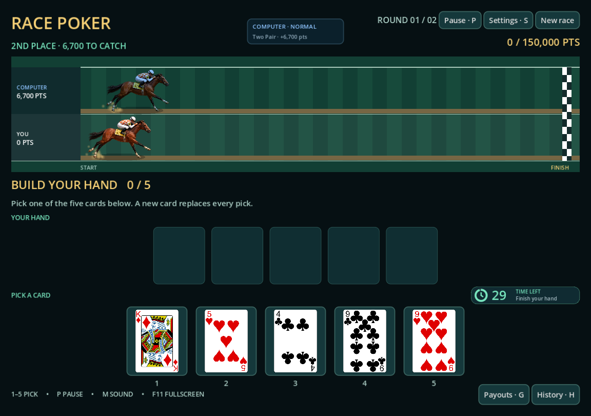
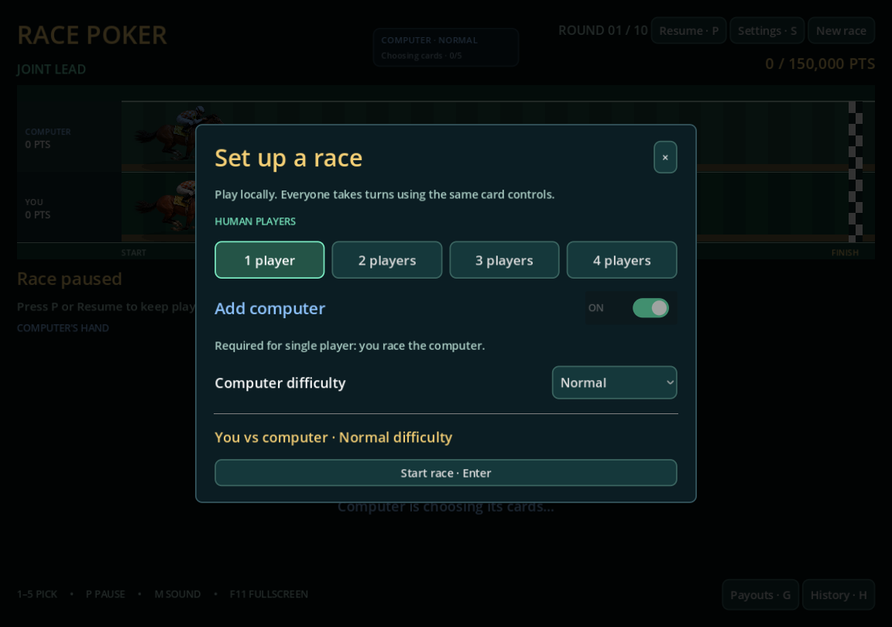
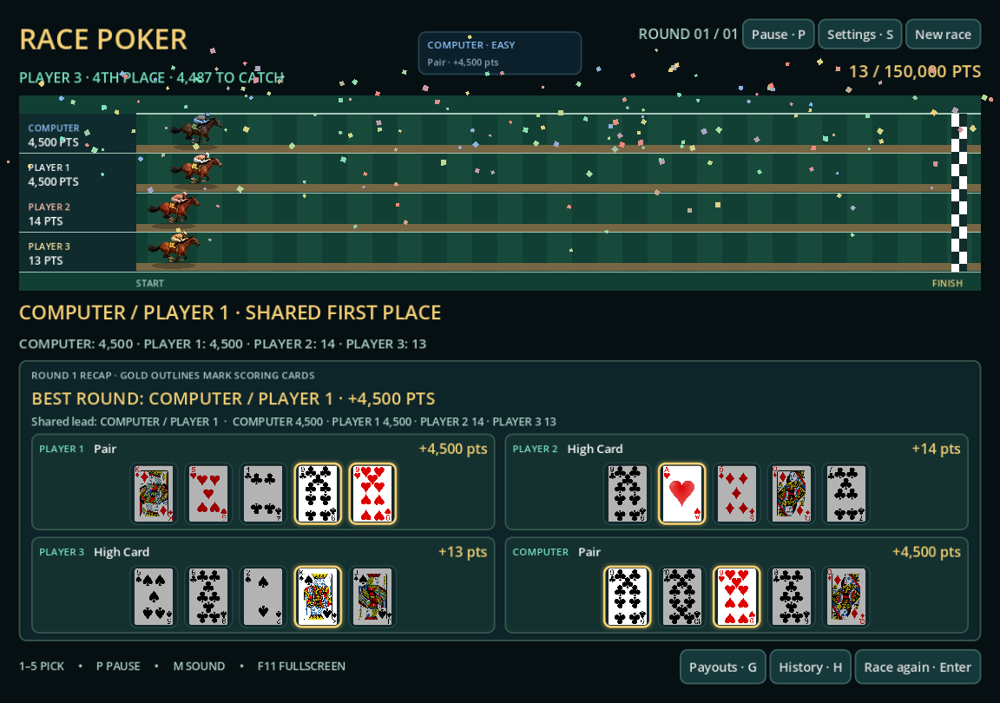
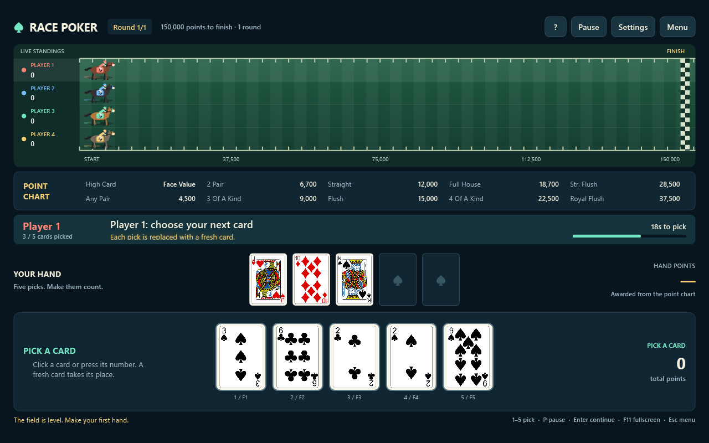
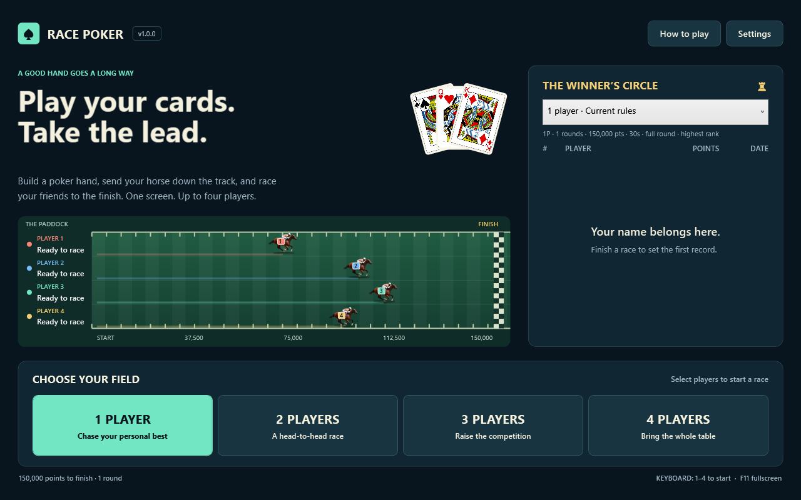
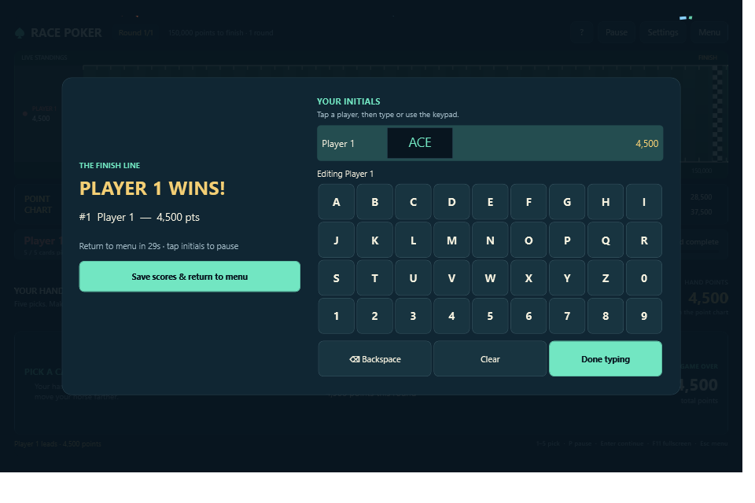

# Race Poker

A Windows arcade game for **1–4 players**. Pick from five face-up cards to build a five-card poker hand, earn points, and race your horse to the finish.

## Play

Download the game from [Releases](https://github.com/primetime43/Poker-Race/releases):

- **Godot edition:** extract `RacePoker-<version>-Windows-x64.zip` and run `RacePoker.exe`. No additional runtime required.
- **WPF edition:** run `RacePoker.Wpf.exe`. Requires the **.NET 10 Desktop Runtime (x64)**.

| Action | Control |
| --- | --- |
| Start a race | Click a player count or press **1–4** |
| Start solo | **Space** or **Enter** in the lobby |
| Pick a card | Click it or press **1–5 / F1–F5** |
| Continue after a round | **Enter** or Continue |
| Pause / resume | **P** or the on-screen button |
| Fullscreen | **F11** |
| Return to menu | **Esc** |

Switching away pauses the race. On the results screen, tap your initials and use the keyboard or touch keypad; **Done** finishes editing.

## Rules and saves

- **Defaults:** 10 rounds, a 150,000-point finish, and 30 seconds to pick. Change these in Settings before starting.
- Hands award the fixed points in the chart. The default race ends after the round in which a horse crosses the finish, or after the final round. Highest total wins; ties share the place.
- Settings and scores save to `%APPDATA%\RacePoker`. Leaderboards keep scores with different rules separate.

See [scoring notes](docs/reference-scoring.md) for the photo-based payouts and cabinet rules that remain unverified.

## Screenshots

### Godot



| Race setup | Multiplayer results |
| --- | --- |
|  |  |

### WPF



| Lobby | Results and touch initials |
| --- | --- |
|  |  |

## Create a release

Push a version tag after committing your changes:

```powershell
git tag v1.1.0
git push origin v1.1.0
```

The [Release action](.github/workflows/release.yml) tests and builds both editions,
then creates or updates the GitHub release with `RacePoker.Wpf.exe` and
`RacePoker-<version>-Windows-x64.zip`. Extract the Godot ZIP and run `RacePoker.exe`;
its runtime is included. Tags set both editions' versions, including prereleases.
Rerun an existing tag through **Actions → Release → Run workflow**.
